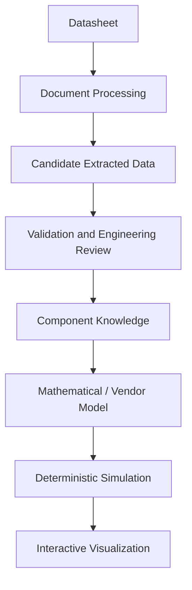

# Architecture

Status: PROPOSED application architecture. These are conceptual boundaries, not
implemented services or a commitment to deployment topology or language.

## Responsibilities and trust

Document processing preserves source identity and evidence locations while
producing candidate observations. OCR, tables, curves, manual entry, and LLM
assistance may disagree. Validation checks structure and physical meaning;
engineering review resolves applicability and ambiguity before promotion.
Rejected or unresolved observations remain visible with their history.

Component knowledge normalizes reviewed facts without erasing original values.
Model selection or calibration is a separate engineering activity: parameters
alone do not determine a complete model. A model requires equations or a vendor
artifact, pin mapping, assumptions, supported analyses, and a validity envelope.

Circuit and simulation configuration specify topology, stimuli, conditions,
analysis, and solver controls. Deterministic backends compute results; failures,
warnings, and convergence diagnostics accompany output. Visualization presents
those results with units and provenance and must not conceal failed runs or
extrapolation. Presentation transforms must remain traceable to raw results.

## Seven distinct entities

| Entity | Responsibility |
| --- | --- |
| Raw source document and evidence | Immutable document identity, revision, rights, and locations. |
| Extracted parameter observation | A candidate reading, with conditions, notation, method, and review history. |
| Normalized component knowledge | Reviewed, versioned facts connected to their observations. |
| Mathematical or vendor model artifact | Explicit model semantics, provenance, parameter mapping, and applicability. |
| Circuit and simulation configuration | Topology, model versions, stimuli, analyses, and reproducibility settings. |
| Simulation result | Computed arrays, diagnostics, run manifest, and completion status. |
| Visualization and explanation | Views and source-grounded explanations referencing evidence and results. |

See the [data model](COMPONENT_DATA_MODEL.md) for the conceptual contracts.

## AI boundary

A local LLM may assist classification, parameter extraction, terminology
normalization, source-grounded retrieval, and engineering explanation. Its output
remains untrusted candidate content. Structured output alone is not validation;
confidence alone is not engineering review. Document text is data, not executable
instructions. No LLM may approve its own extraction or supply authoritative
simulation numbers. Generated model suggestions require independent review and
model validation before use. Ollama is a research reference, not a selected runtime.

## Simulation boundary

The application should submit a versioned run specification to an adapter that
reports capabilities, checks compatibility, maps supported models, executes a run,
and returns normalized results and diagnostics. Backend-specific details remain
explicit inside the adapter and run manifest. Unsupported models or analyses must
fail visibly rather than be silently approximated.

ngspice is the first integration candidate. Evaluate Xyce and existing simulation
workflows before introducing a custom solver. Selection, process versus library
integration, licensing, platform support, and numerical acceptance criteria need
evaluation. See [ADR-0001](decisions/ADR-0001-simulation-backend-boundary.md).
No commitment to Qt, OpenGL, Python, SQLite, or another implementation stack is made.
