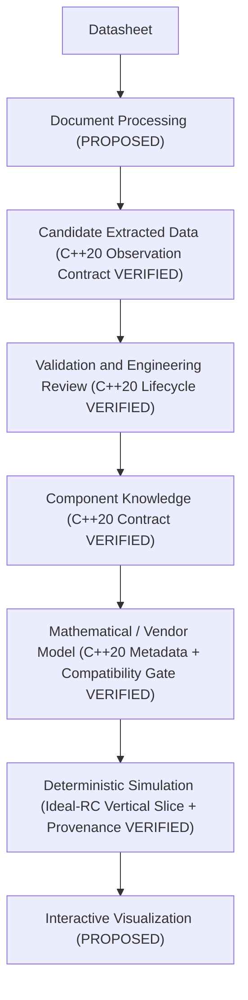

# Architecture

Status: PROPOSED end-to-end application architecture, with three slices now
**IMPLEMENTED and VERIFIED** on Windows x64 (MSYS2 UCRT GCC 16.2.0):

1. **Phase 1 / 1.5 simulation slice (`datasim`)**: manually configured ideal RC
   components, shell-free ngspice-47 batch adapter, common-grid analytical
   validation, and CSV/JSON run reporting ([ADR-0002](decisions/ADR-0002-phase-1-ngspice-executable.md)).
2. **Phase 2 component domain slice (`datasim_component`)**: dependency-free
   in-memory C++20 component identity, source/evidence provenance, parameter
   observations, deterministic human-gated review lifecycle, normalized component
   knowledge with visible conflicts, model artifact descriptors, independent model
   validation records, and referential integrity checks tested on synthetic
   Resistor and Capacitor fixtures ([ADR-0003](decisions/ADR-0003-component-domain-model.md),
   [Phase 2 implementation](PHASE_2_IMPLEMENTATION.md)).
3. **Phase 3 deterministic vertical slice (`datasim_vertical`)**: multi-bundle
   `CircuitAssembly`, SI parameter resolution, model/backend compatibility and
   `ExecutionPolicy` gate, ideal-RC simulation adapter, and traceable
   `provenance_metadata.json` run reporting ([ADR-0004](decisions/ADR-0004-phase-3-vertical-slice.md),
   [Phase 3 implementation](PHASE_3_IMPLEMENTATION.md)).

No PDF/OCR ingestion pipeline, persistent database, LLM runtime, external SPICE
subcircuit loader, semiconductor device solver, or interactive GUI is implemented.

## Responsibilities and trust

Document processing preserves source identity and evidence locations while
producing candidate observations. OCR, tables, curves, manual entry, and LLM
assistance may disagree. Validation checks structure, units, finite numbers, and
referential integrity; engineering review resolves applicability and ambiguity
before promotion. Rejected, superseded, or unresolved observations remain visible
with their history and cannot enter `ComponentKnowledge`.

Component knowledge normalizes reviewed facts without erasing original values,
units, qualifiers, or rating categories. Model selection or calibration is a
separate engineering activity: parameters alone do not determine a complete model,
and absolute maximum stress limits cannot be bound as behavioral model parameters.
A model requires equations or a vendor artifact, ordered terminal-to-pin mapping,
assumptions, supported analyses, limitations, and a validity envelope, plus
independent `ModelValidationRecord` evidence.

Circuit and simulation configuration specify topology, stimuli, conditions,
analysis, and solver controls. Deterministic backends compute results; failures,
warnings, and convergence diagnostics accompany output. Visualization presents
those results with units and provenance and must not conceal failed runs or
extrapolation. Presentation transforms must remain traceable to raw results.

## Seven distinct entities

| Entity | Responsibility | Current implementation boundary |
| --- | --- | --- |
| Raw source document and evidence | Immutable document identity, revision, rights, and locations. | `datasim::component::SourceDocument`, `EvidenceLocation` (in-memory C++20). |
| Extracted parameter observation | A candidate reading, with conditions, notation, method, and review history. | `datasim::component::ParameterObservation`, `OperatingCondition`, `ReviewDecision` (in-memory C++20). |
| Normalized component knowledge | Reviewed, versioned facts connected to their observations and conflicts. | `datasim::component::NormalizedParameter`, `ParameterConflict`, `ComponentKnowledge` (in-memory C++20). |
| Mathematical or vendor model artifact | Explicit model semantics, provenance, parameter mapping, applicability, and independent validation status. | `datasim::component::ModelArtifactDescriptor`, `ModelValidityEnvelope`, `ModelValidationRecord` (metadata only). |
| Circuit and simulation configuration | Topology, model versions, stimuli, analyses, and reproducibility settings. | `datasim::vertical::CircuitAssembly`, `RcRunInputSpecification`, `AdaptedRcSimulation`, `datasim::RcConfig` (ideal-RC vertical slice). |
| Simulation result | Computed arrays, diagnostics, run manifest, and completion status. | `datasim::Samples`, `RunResult`, `datasim::vertical::VerticalRcRunResult`, `VerticalSliceProvenanceManifest`, CSV/JSON artifacts (ideal-RC vertical slice). |
| Visualization and explanation | Views and source-grounded explanations referencing evidence and results. | Not implemented (`PROPOSED`). |

See the [data model](COMPONENT_DATA_MODEL.md) for the entity contracts.

## AI boundary

A local LLM may assist classification, parameter extraction, terminology
normalization, source-grounded retrieval, and engineering explanation in future
stages. Its output remains untrusted candidate content. Structured output alone is
not validation; confidence alone is not engineering review. Document text is data,
not executable instructions. No LLM or automatic parser may approve its own
extraction (`ActorKind::llm_assistant` and `ActorKind::automatic_parser` are
deterministically rejected by `validate_review_decision` and
`validate_model_validation_record`) or supply authoritative simulation numbers.
Ollama remains a research reference, not a selected runtime.

## Simulation boundary

The application should submit a versioned run specification to an adapter that
reports capabilities, checks compatibility, maps supported models, executes a run,
and returns normalized results and diagnostics. Backend-specific details remain
explicit inside the adapter and run manifest. Unsupported models or analyses must
fail visibly rather than be silently approximated.

ngspice executable integration is verified only for the Phase 1/1.5 ideal-RC
transient spike ([ADR-0002](decisions/ADR-0002-phase-1-ngspice-executable.md)).
Evaluate Xyce and existing simulation workflows before introducing a custom solver;
see [ADR-0001](decisions/ADR-0001-simulation-backend-boundary.md). No commitment to
Qt, OpenGL, Python, SQLite, or another application stack is made.
