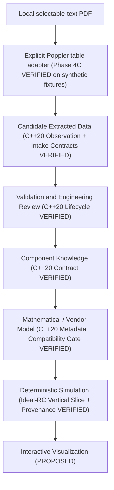

# Architecture

Status: PROPOSED end-to-end application architecture, with three slices now
**IMPLEMENTED and VERIFIED** on Windows x64 (MSYS2 UCRT GCC 16.2.0):

1. **Phase 1 / 1.5 simulation slice (`datasim`)**: manually configured ideal RC
   components, shell-free ngspice-47 batch adapter, common-grid analytical
   validation, and CSV/JSON run reporting ([ADR-0002](decisions/ADR-0002-phase-1-ngspice-executable.md)).
2. **Phase 2 component domain slice (`datasim_component`)**: dependency-free
   in-memory C++20 component identity, source/evidence provenance, parameter
   observations, deterministic human-gated review lifecycle, normalized component
   knowledge with visible conflicts, model artifact descriptors, independent model
   validation records, and referential integrity checks tested on synthetic
   Resistor and Capacitor fixtures ([ADR-0003](decisions/ADR-0003-component-domain-model.md),
   [Phase 2 implementation](PHASE_2_IMPLEMENTATION.md)).
3. **Phase 3 deterministic vertical slice (`datasim_vertical`)**: multi-bundle
   `CircuitAssembly`, SI parameter resolution, fail-closed model/backend compatibility
   and `ExecutionPolicy` metadata gate, ideal-RC simulation adapter, and traceable
   `provenance_metadata.json` run reporting, merged into `main` at
   `6516a629c75662b83f48704bfd7978bcc299ff78` and hardened via PR #3
   (merge `c142a36`) ([ADR-0004](decisions/ADR-0004-phase-3-vertical-slice.md),
   [Phase 3 implementation](PHASE_3_IMPLEMENTATION.md),
   [Phase 3 validation](PHASE_3_VALIDATION.md)).

No OCR pipeline, persistent database, LLM runtime, external SPICE subcircuit
loader, nonlinear semiconductor device solver, real manufacturer datasheet
evaluation, or physical measurement validation (`MEASURED`) is implemented.
The optional Qt 6 `datasim_viewer` provides read-only CSV visualization
(Phase 5A) and manual ideal-RC execution through existing `datasim` contracts
(Phase 5B). CSV loading is worker-threaded with bounded input/sample limits,
and dense waveform painting uses a display-only extrema envelope. It is not a
general circuit editor or approval workflow. See the [Phase 5B hardening audit](PHASE_5B_HARDENING_AUDIT.md)
for Phase 5B hardening evidence and historical gate details. Phase 5B is merged
and post-merge verified (PR #17, hosted run `42176199308`). Phase 5C adds an
optional Qt PDF evidence workspace at the application layer. Qt PDF is used for
document display; existing Poppler-backed `datasim_pdf` remains responsible for
bounded extraction. The application passes complete explicit requests and
renders candidate evidence only; no automatic engineering approval occurs.
See [Phase 5C architecture](PHASE_5C_ARCHITECTURE.md) and
[ADR-0013](decisions/ADR-0013-datasheet-evidence-workbench.md).

The isolated Phase 4B intake (`datasim_intake`), Phase 4C PDF table adapter
(`datasim_pdf`), and Phase 4D PDF-to-Simulation integration gate are **IMPLEMENTED
and VERIFIED** on `main` (PR #6 at `7d9af1c`, PR #7 at
`1704f726d901f3e1d00f9cdc918e80d352b443ac`, and PR #8 at
`69aba4df7ff752355a40e394de5d05ac988df34b`; hosted Windows CI runs
`41995104973`, `42000652152`, `42017272043`, `42023680012`, and `42025406013`).
Phase 4E ([PHASE_4E_VALIDATION.md](PHASE_4E_VALIDATION.md), merged via PR #9 at
`b45c32224e0316dd9f93b6e9bfc3ab89cd3ceaf4`, hosted CI run `42037281172`) adds an
offline evaluation harness (`datasheet_eval_dump` +
`scripts/eval/evaluate_pdf_corpus.py`) benchmarking `datasim_pdf` on synthetic
fixtures and a local pilot corpus of untracked manufacturer PDFs, and Phase 4F
([PHASE_4F_VALIDATION.md](PHASE_4F_VALIDATION.md),
[ADR-0007](decisions/ADR-0007-explicit-header-binding.md), merged via PR #10 at
`9f3c115d13a40204d3d7f83382a50c107b14b803`, hosted CI run `42044651168`) extends `datasim_pdf`
with caller-configured, source-verified column-header unit and condition
bindings (`HeaderUnitBinding` and `HeaderConditionBinding`). Phase 4G
([PHASE_4G_VALIDATION.md](PHASE_4G_VALIDATION.md),
[ADR-0008](decisions/ADR-0008-inline-value-unit-parsing.md)) further extends `datasim_pdf`
with explicitly configured inline value/unit cell parsing (`InlineValueUnitBinding` and
`ValueCellProvenance`). `datasim_pdf` shells
out to local Poppler `pdfinfo` and `pdftotext -bbox-layout`, then passes
explicitly selected text-cell observations through `datasim_intake`. It does not
link Poppler into `datasim_intake` or authenticate source identity.

Phases 4E–4I are bounded extensions of `datasim_pdf`: the offline evaluator,
explicit header unit/condition bindings, inline value/unit bindings, hierarchical
parent/child associations, and baseline-aware host/script associations. Phase 4H
merged via PR #12 (`864eb56c1712470180cc1ecb9d9dbef3b5fd05ff`) and Phase 4I via
PR #13 (`fb35ae1fc5a58dcd6b9f89d7a6807c3198ab99a5`); post-merge Windows CI
runs `42058944651` and `42065262568` succeeded. The CMake dependency graph is
`datasim_vertical -> datasim_component + datasim`,
`datasim_intake -> datasim_component`, and `datasim_pdf -> datasim_intake`;
`datasim` and `datasim_component` remain independent base libraries. Phase 4J
does not change the dependency graph or public contracts; its isolated fix makes
PDF temporary-workspace creation exclusive and protects pre-existing paths. Its
local evidence and hosted PR gate are in
[final validation](PHASE_4_FINAL_VALIDATION.md).

## Responsibilities and trust

Document processing preserves source identity and evidence locations while
producing candidate observations. OCR, tables, curves, manual entry, and LLM
assistance may disagree. Validation checks structure, units, finite numbers, and
referential integrity; engineering review resolves applicability and ambiguity
before promotion. Rejected, superseded, or unresolved observations remain visible
with their history and cannot enter `ComponentKnowledge`.

Phase 4C supports only a selected single-page region with explicit column spans.
It uses extracted text and coordinates as candidates; document identity, exact MPN,
rights, printed-page label, table category, and selection coordinates are caller
configuration. Image-only pages and unsupported layouts fail closed.

Component knowledge normalizes reviewed facts without erasing original values,
units, qualifiers, or rating categories. Model selection or calibration is a
separate engineering activity: parameters alone do not determine a complete model,
and absolute maximum stress limits cannot be bound as behavioral model parameters.
A model requires equations or a vendor artifact, ordered terminal-to-pin mapping,
assumptions, supported analyses, limitations, and a validity envelope, plus
independent `ModelValidationRecord` evidence.

Circuit and simulation configuration specify topology, stimuli, conditions,
analysis, and solver controls. Deterministic backends compute results; failures,
warnings, and convergence diagnostics accompany output. Visualization presents
those results with units and provenance and must not conceal failed runs or
extrapolation. Presentation transforms must remain traceable to raw results.

## Seven distinct entities

| Entity | Responsibility | Current implementation boundary |
| --- | --- | --- |
| Raw source document and evidence | Immutable document identity, revision, rights, and locations. | `datasim::component::SourceDocument`, `EvidenceLocation` (in-memory C++20). |
| Extracted parameter observation | A candidate reading, with conditions, notation, method, and review history. | `datasim::component::ParameterObservation`, `OperatingCondition`, `ReviewDecision` (in-memory C++20). |
| Normalized component knowledge | Reviewed, versioned facts connected to their observations and conflicts. | `datasim::component::NormalizedParameter`, `ParameterConflict`, `ComponentKnowledge` (in-memory C++20). |
| Mathematical or vendor model artifact | Explicit model semantics, provenance, parameter mapping, applicability, and independent validation status. | `datasim::component::ModelArtifactDescriptor`, `ModelValidityEnvelope`, `ModelValidationRecord` (metadata only). |
| Circuit and simulation configuration | Topology, model versions, stimuli, analyses, and reproducibility settings. | `datasim::vertical::CircuitAssembly`, `RcRunInputSpecification`, `AdaptedRcSimulation`, `datasim::RcConfig` (ideal-RC vertical slice). |
| Simulation result | Computed arrays, diagnostics, run manifest, and completion status. | `datasim::Samples`, `RunResult`, `datasim::vertical::VerticalRcRunResult`, `VerticalSliceProvenanceManifest`, CSV/JSON artifacts (ideal-RC vertical slice). |
| Visualization and explanation | Views and source-grounded explanations referencing evidence and results. | Not implemented (`PROPOSED`). |

See the [data model](COMPONENT_DATA_MODEL.md) for the entity contracts.

## AI boundary

A local LLM may assist classification, parameter extraction, terminology
normalization, source-grounded retrieval, and engineering explanation in future
stages. Its output remains untrusted candidate content. Structured output alone is
not validation; confidence alone is not engineering review. Document text is data,
not executable instructions. No LLM or automatic parser may approve its own
extraction (`ActorKind::llm_assistant` and `ActorKind::automatic_parser` are
deterministically rejected by `validate_review_decision` and
`validate_model_validation_record`) or supply authoritative simulation numbers.
Ollama remains a research reference, not a selected runtime.

## Simulation boundary

The application should submit a versioned run specification to an adapter that
reports capabilities, checks compatibility, maps supported models, executes a run,
and returns normalized results and diagnostics. Backend-specific details remain
explicit inside the adapter and run manifest. Unsupported models, unsupported
validity-envelope constraint quantities, or unresolved runtime operating conditions
must fail visibly (fail-closed) rather than be silently approximated or skipped.

In Phase 3 (`datasim_vertical`), `ExecutionPolicy` and `ExecutionClassification`
enforce an explicit metadata gate between synthetic test fixtures (`is_synthetic == true`
or `ExtractionMethod::synthetic_fixture`) and non-synthetic records, while requiring
`ReviewState::approved` knowledge and `ModelValidationStatus::validated_within_envelope`
records authored by `ActorKind::human_engineer`. This gate validates in-memory
metadata and review records only; it does not authenticate real human reviewer
identity, manufacturer identity, datasheet authenticity, external data-source
integrity, or cryptographic signatures. Likewise, `configuration_content_id`,
`netlist_content_id`, and `provenance_content_id` use 64-bit FNV-1a as a deterministic
pre-execution content fingerprint, not cryptographic integrity protection or
tamper-proof authentication.

ngspice executable integration is verified only for the Phase 1/1.5 ideal-RC
transient spike ([ADR-0002](decisions/ADR-0002-phase-1-ngspice-executable.md)).
Evaluate Xyce and existing simulation workflows before introducing a custom solver;
see [ADR-0001](decisions/ADR-0001-simulation-backend-boundary.md). No commitment to
Qt, OpenGL, Python, SQLite, or another application stack is made.

## Phase 4H explicit context extension

[ADR-0009](decisions/ADR-0009-hierarchical-table-context.md) adds source-verified
parent/child configuration and a geometry/text provenance sidecar entirely inside
`datasim_pdf`. Separate parent and child `EvidenceLocation` references survive in
the candidate bundle; detailed boxes and raw text remain in the extraction result.
The dependency graph and intake/review/simulation boundaries are unchanged.
See [implementation](PHASE_4H_IMPLEMENTATION.md) and [validation](PHASE_4H_VALIDATION.md).

## Phase 4I baseline-aware text

[ADR-0010](decisions/ADR-0010-baseline-aware-text-reconstruction.md) adds explicit
host/script selection in `datasim_pdf`. Original coordinates and source strings
are retained; only verified row-association anchors change. Separate provenance
records script roles and display notation. Numeric grammar, global row tolerance,
and downstream trust boundaries remain unchanged. See
[implementation](PHASE_4I_IMPLEMENTATION.md) and [validation](PHASE_4I_VALIDATION.md).
