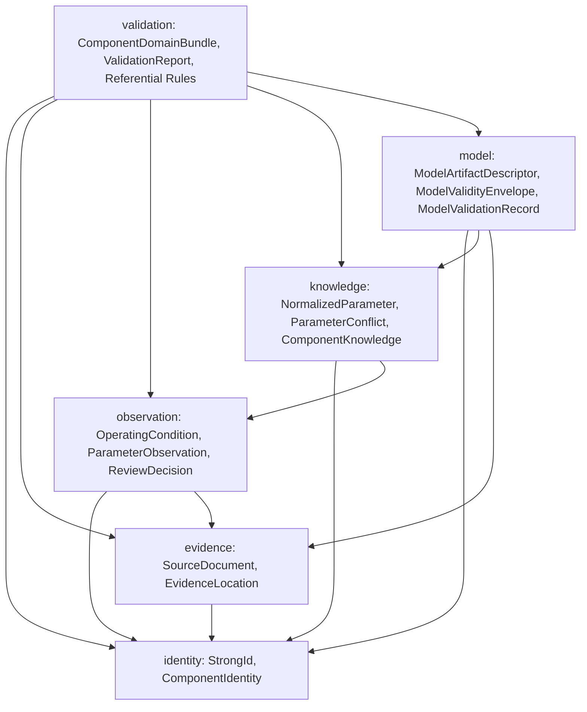

# Phase 2 plan: Component domain model and knowledge contracts

Status: PLANNED work authorized on `feat/phase-2-component-model`, branched from
`origin/main` at `86b924b4b49d69c70c1688a8748cb1c2893adc34` (after PR #1 merged
Phase 1 and Phase 1.5).

## Objective

Translate the conceptual knowledge and model contracts in
[ARCHITECTURE.md](ARCHITECTURE.md), [COMPONENT_DATA_MODEL.md](COMPONENT_DATA_MODEL.md),
and [PROJECT_CHARTER.md](PROJECT_CHARTER.md) into executable, dependency-free C++20
domain types, a deterministic engineering review lifecycle, and deterministic
structural/referential validation rules tested against synthetic Resistor and
Capacitor fixtures.

## Scope and explicit boundaries

### In scope

1. **Component identity**: stable Datasim ID, exact manufacturer, exact part number,
   preserved part-number suffix, package identifier, component family/subtype, and
   explicit synthetic provenance flag.
2. **Source document and evidence location**: immutable document metadata, publisher,
   revision, part-number associations, optional URL, retrieval date, optional
   SHA-256 content digest, usage/redistribution rights, zero-based PDF page index,
   independent printed page label, section, table/figure ID, cell/region, and
   footnotes.
3. **Parameter observations, qualifiers, categories, and operating conditions**:
   original parameter name, verbatim value notation, original unit symbol, optional
   finite scalar value (missing remains missing, never zero), distinct
   `minimum`/`typical`/`maximum`/`unspecified` qualifier, explicit rating category
   (`absolute_maximum_rating`, `recommended_operating_condition`,
   `electrical_characteristic`, `thermal_characteristic`, `other_unspecified`),
   operating conditions retaining units, extraction provenance, and review audit
   history.
4. **Deterministic engineering review lifecycle**: explicit transitions
   (`candidate -> needs_review -> approved | rejected`, `approved -> superseded`),
   accountable human reviewer requirement for approval/rejection/supersession,
   prohibition of LLM/parser self-approval, rationale, timestamps, evidence
   references, and mandatory replacement links for superseded observations.
5. **Normalized parameters and component knowledge**: canonical parameter names,
   quantity descriptions, explicit documented conversion rules (no automatic unit
   converter), preserved original text/unit and observation links, version history,
   visible conflicting-observation records (never silently averaged or overwritten),
   and knowledge-level engineering review decision.
6. **Model artifact descriptor and independent model validation metadata**: model ID,
   version, format (`analytical_equation`, `spice_model_card`, `spice_subcircuit`,
   `lookup_table`, `vendor_specific_artifact`), source/vendor, external URI and
   optional SHA-256, license/usage restrictions, ordered terminal-to-pin mapping,
   parameter mappings (blocking misuse of absolute maximum ratings as behavioral
   model parameters), validity envelope ranges, supported analyses, limitations, and
   separate `ModelValidationRecord` tracking.
7. **Referential integrity and synthetic passive fixtures**: bundle-wide ID
   uniqueness and cross-entity resolution checks, unit-tested exclusively with
   synthetic Resistor and Capacitor fixtures marked as synthetic.

### Out of scope

- PDF parsing, OCR, curve digitization, or real vendor datasheet ingestion.
- Local or remote LLM/Ollama integration, RAG, or vector stores.
- SQLite/database persistence or general-purpose JSON serialization.
- Automatic general-purpose unit conversion engines.
- Semiconductor equations, diode/BJT/MOSFET models, or new simulation backends.
- Schematic editors, GUI toolkits, OpenGL/Vulkan visualization, or GPU compute.
- Any modification to Phase 1/1.5 RC simulation behavior, CSV format, tolerances, or
  historical validation artifacts.

## Module architecture

Phase 2 introduces a standalone CMake static library target `datasim_component`
under `src/datasim/component/` in `namespace datasim::component`, completely
decoupled from `src/datasim/simulation/`, process launching, `<filesystem>`, and
ngspice:

See [ADR-0003](decisions/ADR-0003-component-domain-model.md) for the architectural
rationale, alternatives considered, and compatibility guarantees.

## Work packages

| Package | Deliverable | Verification |
| --- | --- | --- |
| WP1: Documentation reconciliation | Align `AGENTS.md`, `docs/AGENTS.md`, `README.md`, `PROJECT_CHARTER.md`, `ROADMAP.md`, `PHASE_1_ARCHITECTURE_REVIEW.md` with PR #1 merge state; record `PHASE_2_PLAN.md` and `ADR-0003`. | Relative link and status consistency review. |
| WP2: C++20 domain types and lifecycle | Implement `identity/`, `evidence/`, `observation/`, `knowledge/`, `model/`, and `validation/` under `src/datasim/component/`; build `datasim_component` with `-Wall -Wextra -Wpedantic`. | Clean CMake/Ninja compilation without warnings or third-party dependencies. |
| WP3: Synthetic fixtures and unit tests | Build synthetic Resistor and Capacitor bundles and unit tests covering all positive, negative, lifecycle, conflict, and referential-integrity cases. | `ctest` passes `component_model` alongside existing `unit`, `backend_errors`, and real `ngspice_rc` tests with zero skips. |
| WP4: Phase 2 documentation and CI | Record `PHASE_2_IMPLEMENTATION.md` and `PHASE_2_VALIDATION.md`; update `COMPONENT_DATA_MODEL.md`, `ARCHITECTURE.md`, `VALIDATION_STRATEGY.md`, `ROADMAP.md`, `PROJECT_CHARTER.md`, `README.md`; verify hosted Windows CI and open PR against `main`. | Local CTest 4/4 pass (zero skips) and hosted GitHub Actions pass. |

## Exit criteria

Phase 2 is complete only when:

1. All domain entities and four-way trust separations (observation approval,
   component knowledge approval, model registration, model validation) are
   implemented in C++20 and deterministically validated.
2. Original notation, units, qualifiers, operating conditions, exact part suffixes,
   and conflicting observations are preserved without silent coercion or averaging.
3. Invalid review transitions, missing reviewers/rationales/evidence, and LLM/parser
   self-approvals are deterministically rejected.
4. Synthetic Resistor and Capacitor fixtures pass full bundle validation and unit
   tests cover all required positive and negative cases.
5. Phase 1 and Phase 1.5 unit, fault, and real `ngspice_rc` integration tests pass
   without modification or regression locally and in hosted Windows CI.
6. Documentation accurately distinguishes implemented in-memory C++20 contracts from
   deferred persistence, extraction, and simulation-coupling work.
