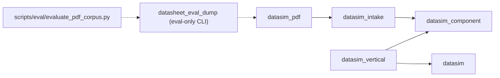

# Phase 4E Plan — Real Datasheet Evaluation Corpus and Offline Benchmark

- **Phase**: 4E
- **Status**: IMPLEMENTED and VERIFIED on `feat/phase-4e-datasheet-evaluation-corpus` (synthetic regression suite verified in CTest; real-datasheet pilot corpus evaluated locally against untracked manufacturer PDFs in `build/corpus/`)
- **Baseline**: `main` at `69aba4df7ff752355a40e394de5d05ac988df34b` (PR #8 merge of Phase 4D, verified by hosted Windows CI run [`42025406013`](https://github.com/quocthaile/datasim/actions/runs/42025406013))
- **Related Documents**:
  - [Phase 4E Corpus Protocol](PHASE_4E_CORPUS_PROTOCOL.md)
  - [Phase 4E Validation Report](PHASE_4E_VALIDATION.md)
  - [Phase 4C Plan](PHASE_4C_PLAN.md) and [ADR-0006](decisions/ADR-0006-deterministic-pdf-table-extraction.md)
  - [Phase 4D Validation](PHASE_4D_VALIDATION.md)

## 1. Objective

Phase 4C (`datasim_pdf`) and Phase 4D (`pdf_simulation_gate`) verified deterministic PDF table extraction and its end-to-end connection to `ngspice-47` using controlled, legally distributable synthetic PDF fixtures (`tests/fixtures/synthetic_datasheet.pdf` and `tests/fixtures/image_only_datasheet.pdf`). Neither Phase 4C nor Phase 4D measured extraction quality on real manufacturer datasheets.

Phase 4E introduces a reproducible, human-annotated evaluation corpus protocol and offline benchmark runner (`scripts/eval/evaluate_pdf_corpus.py` + development-only adapter `apps/datasheet_eval_dump/main.cpp`) to measure real-document and synthetic-fixture extraction quality and classify failure modes without extending the production parser (`datasim_pdf`), adding OCR, integrating an LLM, or altering simulation contracts.

## 2. Architectural Boundaries

Phase 4E preserves the existing five-library production dependency graph unchanged:

1. **Zero production contract changes**: `datasim`, `datasim_component`, `datasim_vertical`, `datasim_intake`, and `datasim_pdf` public headers and implementation files are untouched.
2. **Real extraction path execution**: `scripts/eval/evaluate_pdf_corpus.py` invokes `datasheet_eval_dump`, which calls `datasim::pdf::extract_electrical_table(const ExtractionRequest&)` with the configured Poppler `pdfinfo` and `pdftotext` executables. PDF parsing is never reimplemented in Python.
3. **Candidate-only trust boundary**: Ground-truth annotations (`datasim.phase4e.annotations.v1`) are offline evaluation labels only and are never promoted to `ComponentKnowledge`. The evaluator explicitly verifies that every observation emitted by `datasim_pdf` has `review_state == candidate` and `review_history_count == 0`.
4. **Strict licensing and data governance**: Manufacturer PDFs (`redistribution_permitted = false`) and verbatim vendor table annotations are stored exclusively in the untracked `build/corpus/` directory and are never committed to Git or uploaded to GitHub Actions artifacts.

## 3. Scope and Deliverables

1. **Corpus Protocol ([`docs/PHASE_4E_CORPUS_PROTOCOL.md`](PHASE_4E_CORPUS_PROTOCOL.md))**:
   - Defines the supported Phase 4C extraction subset, six layout/eligibility categories, recruitment targets, licensing/rights governance, versioned manifest and ground-truth annotation schemas (`datasim.phase4e.corpus.v1` and `datasim.phase4e.annotations.v1`), deterministic matching policy, four-part metric separation, and the 16-label error taxonomy.
2. **Development-Only Extraction Adapter ([`apps/datasheet_eval_dump/main.cpp`](../apps/datasheet_eval_dump/main.cpp))**:
   - Accepts full `ExtractionRequest` parameters via CLI flags, calls `datasim::pdf::extract_electrical_table()`, and serializes the resulting `ExtractionResult` (`IntakeManifest`, `CandidateBundle` status, `IntakeReport` diagnostics, `domain_validation` issues, `evidence`, and `observations`) to deterministic JSON.
3. **Offline Corpus Evaluator ([`scripts/eval/evaluate_pdf_corpus.py`](../scripts/eval/evaluate_pdf_corpus.py))**:
   - Validates manifest and annotation schemas, checks Poppler versions and PDF SHA-256 digests prior to extraction, executes each case (and a repeat run when enabled), computes observation-level (`TP`, `FP`, `FN`, `Precision`, `Recall`, `F1`) and field-level agreement metrics with explicit denominators, verifies fail-closed rejection on unsupported layouts, classifies diagnostics into the 16-label taxonomy, and writes deterministic JSON and Markdown reports.
4. **Public Synthetic Regression Suite & Real-Datasheet Pilot Corpus**:
   - [`tests/evaluation/synthetic_corpus_manifest.json`](../tests/evaluation/synthetic_corpus_manifest.json) and [`tests/evaluation/synthetic_ground_truth.json`](../tests/evaluation/synthetic_ground_truth.json): 7 cases across `synthetic_datasheet.pdf` and `image_only_datasheet.pdf`.
   - [`tests/evaluation/test_pdf_corpus_evaluator.py`](../tests/evaluation/test_pdf_corpus_evaluator.py): automated `unittest` and CTest (`pdf_corpus_evaluation`) suite verifying determinism, case-order independence, SHA-256 mismatch rejection, missing-PDF handling, empty ground-truth handling, and schema validation.
   - [`evaluation/real_corpus_manifest.json`](../evaluation/real_corpus_manifest.json): source metadata, rights classifications, SHA-256 digests, and operator-selected table geometries for 7 real-world candidate documents (5 locally evaluated Vishay datasheets in `build/corpus/` + 2 excluded KEMET URLs).
5. **Validation Report ([`docs/PHASE_4E_VALIDATION.md`](PHASE_4E_VALIDATION.md))**:
   - Records exact commands, environment versions, SHA-256 digests, synthetic CI metrics, local real-corpus pilot metrics, failure-mode breakdown, and prioritized recommendations for a future parser-improvement phase.

## 4. Non-Goals

- Modifying `datasim_pdf` parsing heuristics or relaxing non-overlapping column-span validation to make complex vendor tables pass.
- Committing copyrighted vendor PDFs or verbatim vendor table dumps to the public repository.
- Claiming multi-annotator consensus (`annotator_count = 1`, `inter_annotator_agreement_claimed = false`).
- Adding OCR, GUI table selection, persistent storage, LLM assistance, or new simulation models.

