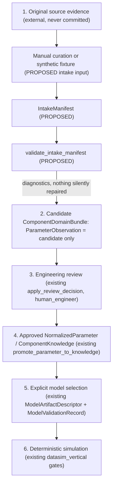

# Phase 4 plan: Deterministic datasheet evidence intake (Phase 4A planning)

Status: **PLANNED / PROPOSED — planning only.** This document implements nothing.
Every new API, type, schema, or module named here is `PROPOSED` and does not exist in
the repository. Phase 4B implementation is **not authorized** until the owner accepts
this plan and [ADR-0005](decisions/ADR-0005-evidence-intake-boundary.md). Test design:
[Phase 4 validation plan](PHASE_4_VALIDATION_PLAN.md).

## 1. Baseline and Phase 3 release-gate evidence

| Item | Observed value (2026-11-04) |
| --- | --- |
| Remote `origin/main` | `c142a36ceba42ce318d4a4d6b2d448e177e35eb2` (Merge pull request #3) |
| PR #3 | `closed`, `merged=true`, merged `2026-11-04T03:15:59Z`, head `b99ef8331e8d243d21cfdddd66e8958ca80b1c65`, base `main`, 15 files, 0 review comments, 0 reviews (GitHub REST API, unauthenticated read) |
| Local `main` at start | `6516a62` (behind 3); fast-forwarded to `c142a36` (clean tree, `--ff-only`) |
| Planning branch | `docs/phase-4a-evidence-intake-plan`, created from `c142a36` |
| Hosted CI, push to `main` at `c142a36` | [run 41766031217](https://github.com/quocthaile/datasim/actions/runs/41766031217): job `windows-ucrt` `success`; all steps `success` including "Required real backend integration" and "Convergence and repeatability" |
| Hosted CI, PR #3 head `b99ef83` | pull_request run `41318097163` and push run `41318091735`: `success` (2026-11-01) |

The task brief stated `main` = `6516a62…` and PR #3 as open; both were stale. PR #3 was
merged before this task started, so it is reported as **merged**, not "ready for owner
review".

### 1.1 Local verification executed in this task

Environment: Windows x64, MSYS2 UCRT64 `g++.exe (Rev5, Built by MSYS2 project) 16.1.0`,
CMake 4.3.2, Python 3.13.12, generator `MinGW Makefiles` (Ninja absent),
Release. Commands (PATH prefixed with `C:\msys64\ucrt64\bin`):

```text
cmake -S . -B build/phase4a-baseline -G "MinGW Makefiles" -DCMAKE_BUILD_TYPE=Release
cmake --build build/phase4a-baseline -j 4
ctest --test-dir build/phase4a-baseline --output-on-failure
python -m unittest discover -s tests/ci -v
```

| Check | Outcome |
| --- | --- |
| Clean configure/build, `-Wall -Wextra -Wpedantic` | built, all targets |
| CTest `unit` / `component_model` / `vertical_slice` / `backend_errors` | **Passed** (92 / 270 / 1483 checks printed by the executables; `backend_errors` passed) |
| CTest `ngspice_rc` (real backend integration) | **Skipped — `NOT VERIFIED` locally.** No `ngspice_con.exe` is installed on this machine and `DATASIM_NGSPICE` was not set. A skip is not a pass. |
| `rc_study.exe` six-run study | **Not run (`NOT VERIFIED` locally)** — requires ngspice |
| `python -m unittest discover -s tests/ci -v` | 5/5 `OK` |
| Real ngspice-47 integration, byte-identical RC equivalence | **VERIFIED only by hosted CI** (run 41766031217 step success); local reproduction `NOT VERIFIED`. CI step logs need authentication and were not read, so "0 skips" for that run is taken from the workflow design (`DATASIM_NGSPICE` configured), not observed. |

CTest aggregate "100% tests passed, 0 failed out of 5" included the skipped test.

### 1.2 Phase 3 readiness findings (PR #3 retrospective review)

Scope read: `git diff 6516a62..b99ef83` for `src/` and `tests/`, plus all Phase 2/3
documents and ADR-0003/0004. No `src/` change was made by this task.

Verified retained properties (by code reading and the passing 1483-check suite):
fail-closed `ModelValidityEnvelope` evaluation, `ExecutionPolicy` /
`ExecutionClassification` gate over component, `SourceDocument`, observation
`ExtractionMethod::synthetic_fixture` and model markers, human-only
`ModelValidationRecord`, pre-execution provenance gate, and unchanged `datasim`
numerical sources. No blocking defect was found.

Non-blocking findings (reported, **not fixed**; Phase 3 source changes were out of
scope):

| ID | Finding | Evidence | Disposition |
| --- | --- | --- | --- |
| F1 | Stale status text: several documents still describe Phase 3 as "hardened on `fix/phase3-validation-hardening`" / "VERIFIED on `feat/phase-3-vertical-slice`" although PR #3 merged. | `README.md`, `docs/AGENTS.md`, `docs/ARCHITECTURE.md`, `docs/ROADMAP.md`, `docs/PROJECT_CHARTER.md`, `docs/decisions/ADR-0004-…` | Reconciled in this branch where stated below; root `AGENTS.md` (owner rule file) **not edited**, flagged for owner. |
| F2 | `is_source_document_applicable` compares only `part_number`; manufacturer vs `publisher` and `part_number_suffix` are ignored, and the convention for whether `associated_part_numbers` holds base or suffixed numbers is undefined. | `src/datasim/component/validation/domain_validation.cpp` (`is_source_document_applicable`); scratch probe: mismatching publisher + suffix → `applicable=1`; case-different part number → `0`. | Phase 4 prerequisite; addressed by intake checks / owner decision D2. |
| F3 | `validate_evidence_location` accepts any `pdf_page_index` (probe: `99999` valid); `SourceDocument` has no page count. | same file; probe | Intake-level bound proposed (D1/D3). |
| F4 | Hosted CI step "Required real backend integration" relies on `ctest -L integration`; CTest treats an exit-77 skip as "not run" with exit code 0, so the workflow does not itself assert non-skip. | `.github/workflows/rc-validation.yml` | Suggest `--no-tests=error` and skip detection in a separate authorized CI task. |
| F5 | `ReviewDecision` self-approval prevention covers only `extraction_tool == reviewer.id`; a curator may approve their own manual entry. | `validate_parameter_observation` | Open decision D5. |
| F6 | `OperatingEnvironment` fields changed from `double` to `std::optional<double>` in PR #3 (API change inside `datasim_vertical`). All in-repo callers compile and pass; no external consumers exist. | `model_compatibility.hpp` diff | Informational. |
| F7 | Fixture `content_sha256` values are placeholder patterns (`0123…`, `fedcba98…`), not digests of real documents. | `tests/unit/component_fixtures.cpp` | Intake must never treat any digest as evidence of authenticity. |

Missing negative tests relevant to Phase 4 (domain level, not Phase 3 defects): no
test for document/component publisher mismatch, suffix mismatch, out-of-range PDF page
index, or curator-equals-approver; these are specified in the validation plan against
the proposed intake layer.

## 2. Current implemented architecture and exact contracts to reuse

Three static libraries exist (`CMakeLists.txt`): `datasim` (ideal-RC simulation,
ngspice executable), `datasim_component` (`namespace datasim::component`,
dependency-free), and `datasim_vertical` (`namespace datasim::vertical`, links both).

Contracts below are quoted from headers on `c142a36`; Phase 4 reuses them unchanged.

| Contract | Fields / invariants that matter for intake |
| --- | --- |
| `SourceDocument` | `id` (`SourceDocumentId`), `publisher`, `title`, `associated_part_numbers`, `revision`, `original_url?`, `retrieval_date?`, `content_sha256?` (64 hex), `usage_rights` (`DocumentUsageRights`), `is_synthetic`. Metadata only; never embeds the PDF. |
| `DocumentUsageRights` | `license_identifier?`, `redistribution_permitted` (default `false`), `restriction_notes` (non-blank required). |
| `EvidenceLocation` | `id`, `source_document_id`, `pdf_page_index?` (zero-based `std::size_t`), `printed_page_label?`, `section?`, `table_or_figure_id?`, `cell_or_region?`, `footnote_refs`. At least one locator required; neither page field is derived from the other. No row/column fields. |
| `ParameterObservation` | see [ADR-0005](decisions/ADR-0005-evidence-intake-boundary.md#context); `unitless` with `original_unit_symbol` is contradictory; `parsed_numeric_value` requires `original_value_text` and a unit (unless `unitless`); at least one `evidence_refs` entry; automated `ExtractionMethod` values require `extraction_tool`; approval requires non-blank `original_value_text`. `extracted_at`, `extraction_tool_version`, `uncertainty_note` are optional strings. |
| `OperatingCondition` | `parameter_name`, `original_value_text`, `unit_symbol`, `numeric_value?`, `notes?`. |
| `ValueQualifier` | `minimum`, `typical`, `maximum`, `unspecified`. |
| `ParameterCategory` | `absolute_maximum_rating`, `recommended_operating_condition`, `electrical_characteristic`, `thermal_characteristic`, `other_unspecified`. |
| `ExtractionMethod` | `manual_entry`, `synthetic_fixture`, `deterministic_table_parser`, `deterministic_text_parser`, `curve_digitization`, `ocr`, `llm_assisted`. |
| `ReviewState`, `ReviewDecision`, `ReviewerIdentity`, `ActorKind` | `candidate`, `needs_review`, `approved`, `rejected`, `superseded`; transitions per `is_valid_review_transition`; `requires_human_engineer_reviewer`; `apply_review_decision(ParameterObservation&, const ReviewDecision&)` (strong exception safety). `ActorKind::llm_assistant` and `automatic_parser` are rejected for every decision. |
| `NormalizedParameter`, `make_normalized_parameter` | derived only from an approved observation with an explicit `conversion_rule`; preserves original text, unit, qualifier, category, `source_observation_id`. |
| `ComponentKnowledge`, `promote_parameter_to_knowledge`, `ParameterConflict` | approved, versioned, conflicts visible and never averaged; unapproved or conflicted observations rejected. |
| `ComponentDomainBundle`, `validate_domain_bundle`, `ValidationReport`, `ValidationRuleCode`, `ensure_valid` | single-component aggregate; referential integrity (observation→evidence→document, `component_id`, synthetic provenance mismatch, `incompatible_source_document_part_number`). |
| `ModelArtifactDescriptor`, `ModelValidationRecord`, `effective_model_validation_status` | untouched by intake; reached only after approved knowledge. |
| `ExecutionPolicy`, `ExecutionClassification`, `evaluate_rc_model_compatibility`, `resolve_rc_parameters` | Phase 3 simulation-side gates, unchanged. |

Current limitations relevant to Phase 4: no producer of observations from external data;
no document page count; no row/column/symbol fields; no manufacturer or suffix check
against documents (F2); no curator/reviewer separation (F5); no persistence or
serialization; no unit conversion beyond reviewed `NormalizedParameter` records.

## 3. Proposed intake data flow



The six boundaries map to six distinct data holders:

1. **Source evidence**: `SourceDocument` + `EvidenceLocation` (metadata and locators).
2. **Candidate observations**: `ParameterObservation` in `ReviewState::candidate`.
3. **Review decisions**: `ReviewDecision` in `review_history` (created only by a
   reviewer, never by intake).
4. **Approved normalized knowledge**: `NormalizedParameter`, `ComponentKnowledge`.
5. **Selected models**: `ModelArtifactDescriptor`, `ModelValidationRecord`.
6. **Execution**: `datasim_vertical` and `datasim`.

## 4. Proposed intake interface (all `PROPOSED`)

```text
module   datasim_intake            (PROPOSED)  links datasim_component only
namespace datasim::intake          (PROPOSED)
IntakeOriginClass                  (PROPOSED)  { synthetic_fixture, manual_curation }  — no "verified" value
IntakeManifest                     (PROPOSED)  schema_version, origin, curator ReviewerIdentity,
                                               ComponentIdentity claimed, SourceDocument,
                                               declared_pdf_page_count?, publisher_differs_declaration?,
                                               vector<IntakeEvidenceEntry>, vector<IntakeObservationEntry>
IntakeEvidenceEntry                (PROPOSED)  EvidenceLocation + optional row_label, column_label (D3)
IntakeObservationEntry             (PROPOSED)  ParameterObservation (candidate) + raw_symbol?, raw_qualifier_text?,
                                               raw_conditions_text?, ambiguity_notes
IntakeDiagnosticCode / IntakeDiagnostic (PROPOSED)
validate_intake_manifest(...)      (PROPOSED)  -> IntakeReport (domain ValidationReport + intake diagnostics)
build_candidate_bundle(...)        (PROPOSED)  -> ComponentDomainBundle, only if validation has no errors
```

Guarantees of `build_candidate_bundle` (PROPOSED): every observation is `candidate`
with empty `review_history` and null `superseded_by`; `knowledge`, `models`,
`model_validations` empty; `validate_domain_bundle` is invoked and must be valid;
identifiers are preserved exactly as supplied; no field is defaulted from another
(page index ↔ printed label, qualifier ↔ category, unit ↔ parameter name).

## 5. Capture requirements (how each datum is represented)

| Datum | Representation | Rule when missing/ambiguous |
| --- | --- | --- |
| Manufacturer, part number, suffix | `ComponentIdentity::manufacturer`, `part_number`, `part_number_suffix`, `package_id`; compared exactly (no case folding, trimming, or suffix stripping) with `SourceDocument::publisher` / `associated_part_numbers` by intake | mismatch ⇒ error; unknown suffix stays `std::nullopt` |
| Title, revision, URL | `SourceDocument::title`, `revision`, `original_url?`, `retrieval_date?` | URL stays `std::nullopt`; never guessed |
| Document identity & rights | `SourceDocument::id`, `content_sha256?` (claim only), `DocumentUsageRights` | missing rights ⇒ `redistribution_permitted=false` and non-blank `restriction_notes`; documents with `redistribution_permitted=false` may be described but never stored |
| PDF page vs printed page | `EvidenceLocation::pdf_page_index` (zero-based) and `printed_page_label` | both kept; neither derived; index bounded by declared page count when supplied |
| Section/table/figure/row/column/footnotes | `section`, `table_or_figure_id`, `cell_or_region`, `footnote_refs`; row/column per D3 | absent stays `std::nullopt` |
| Parameter name & notation | `ParameterObservation::parameter_name` verbatim (symbol per D3) | no canonicalization at intake |
| Value & unit strings | `original_value_text`, `original_unit_symbol` verbatim; `unitless` only when the source states no unit | missing value ⇒ `std::nullopt` (candidate allowed, can never be approved); missing unit ⇒ no `parsed_numeric_value` |
| Parsed number | `parsed_numeric_value` in the **original** unit, only for a strict single decimal/scientific literal | ranges, tolerances, `<`/`>`, footnote-marked, locale-ambiguous (`1,000`) ⇒ `std::nullopt` + diagnostic |
| Qualifier | `ValueQualifier`; one observation per min/typ/max cell | unlabeled ⇒ `unspecified`; never merged |
| Category | `ParameterCategory`; `absolute_maximum_rating` is never converted to `recommended_operating_condition` or electrical parameters | unknown ⇒ `other_unspecified` |
| Operating conditions | `OperatingCondition` per condition (temperature, voltage, frequency, other) with original text and unit; `numeric_value` only when unambiguous | missing unit ⇒ rejected condition (existing `validate_operating_condition`) |
| Method, tool, uncertainty | `extraction_method`, `extraction_tool`, `extraction_tool_version`, `extracted_at`, `uncertainty_note` | automated methods require tool (existing rule) |
| Links | `ParameterObservation::evidence_refs` → `EvidenceLocation::id` → `SourceDocument::id` | unresolved ⇒ error (existing `unresolved_reference`) |

## 6. Trust boundaries and review requirements

- Intake output is **untrusted candidate data**; it cannot enter
  `ComponentKnowledge` or any `datasim_vertical` call path (no dependency edge).
- Moving a candidate to `needs_review` uses `apply_review_decision` with a
  non-LLM/non-parser actor (`ActorKind::automated_check` or `human_engineer`);
  approval/rejection requires `human_engineer` plus ISO-8601 timestamp, rationale,
  and resolvable `evidence_refs` (existing rules).
- A reviewer must compare the original external document; the in-repo data cannot
  prove they did. Review is **metadata review**, not authentication of a person or
  document (ADR-0005).
- `synthetic_fixture` and `manual_curation` are the only origin classes. Synthetic
  data is marked consistently on component, document, observation
  (`ExtractionMethod::synthetic_fixture`), and later model, and is rejected by
  `ExecutionPolicy::engineering_approved_only`. No code path labels synthetic data as
  manufacturer data; mixed synthetic/non-synthetic provenance is an error.
- Absolute maximum ratings remain `ParameterCategory::absolute_maximum_rating`;
  existing `absolute_maximum_misused_as_model_parameter` and Phase 3
  `resolve_rc_parameters` category checks remain the downstream barrier.

## 7. Component-to-source referential integrity requirements

Every candidate must satisfy, in addition to `validate_domain_bundle`:

1. `ParameterObservation::component_id == ComponentIdentity::id` of the manifest.
2. Every `evidence_refs` entry resolves to an `EvidenceLocation` in the same manifest;
   each `EvidenceLocation::source_document_id` resolves to the manifest's document.
3. Manufacturer, part number, and suffix of the component are consistent with the
   document (exact comparison; convention D1).
4. Page index within the declared page count; printed label preserved separately.
5. Identifier uniqueness for `ObservationId`, `EvidenceId`, `SourceDocumentId`.
6. Synthetic flags consistent across component, document, and observations.
7. Competing observations (same parameter name, qualifier, category, conditions,
   different values) are reported as conflict candidates and **not merged**; formal
   `ParameterConflict` records are created only during review/promotion.

## 8. Minimal feature scope

In scope for a later authorized Phase 4B: the intake structures, validation, candidate
bundle builder, synthetic fixtures, tests listed in the validation plan, and
documentation. Out of scope: PDF/OCR, automated ingestion, LLM/Ollama, database or
persistence, general JSON serialization, GUI, new solvers or semiconductor models, GPU,
unit-conversion engine, changes to `datasim`, `datasim_component`, or `datasim_vertical`.

## 9. Work packages (planning level)

| WP | Deliverable | Authorized now? |
| --- | --- | --- |
| 4A-WP-A | Phase 3 readiness assessment (§1) | Done (documentation only) |
| 4A-WP-B | Scope and contract inventory (§2–§7) | Done (documentation only) |
| 4A-WP-C | Intake boundary design (ADR-0005) | Done, `PROPOSED` |
| 4A-WP-D | Validation design ([plan](PHASE_4_VALIDATION_PLAN.md)) | Done, `PROPOSED` |
| 4B-1 … 4B-7 | Implementation sequence (§12) | **No — needs owner acceptance** |

## 10. Technical alternatives and trade-offs

See [ADR-0005 alternatives](decisions/ADR-0005-evidence-intake-boundary.md#alternatives-considered).
Summary: new library vs extending `datasim_component` (isolation vs duplication of
checks); sidecar fields vs contract extension (no verified-contract churn vs lost
visibility in the bundle); intake-level vs domain-level identity checks (no Phase 2
change vs two validators); manual fixtures vs parser prototype (deterministic and
legal vs no real-world signal).

## 11. Licensing, security, and reproducibility limitations

- Licensing: no vendor datasheet, vendor model, or excerpt may be committed; real
  datasheets are referenced by metadata only. The repository has no adopted license
  (existing open question), so synthetic fixture redistribution terms follow the
  existing fixture convention until the owner decides.
- Security: document-derived strings are data; intake must not execute, evaluate, or
  interpolate them; strings with control characters or newlines are rejected by
  existing single-line checks. No hash/signature authenticity.
- Reproducibility: intake is a pure function of its input structures (no clock,
  network, or filesystem access); `extracted_at` is caller-supplied. No accuracy claim
  for real documents is made or measurable with synthetic fixtures. Phase 1/1.5
  numerical results (0.05 V tolerance; results.csv SHA-256 `9c923c4d…26f9`) and Phase
  2/3 suites (92 / 270 / 1483 checks) must remain unchanged.

## 12. Incremental implementation sequence (for a later authorized task)

1. **4B-0**: owner decisions D1–D6; optional hardening task for F2/F3 if D2 selects
   domain-level fix (separate PR, Phase 2 suite must stay green).
2. **4B-1**: `datasim_intake` skeleton, CMake target linking `datasim_component`,
   `IntakeOriginClass`, report types; no behavior.
3. **4B-2**: identity/document/location checks (manufacturer, MPN+suffix, page bounds).
4. **4B-3**: observation checks (raw preservation, strict numeric parse, qualifier,
   category, conditions, unsupported unit conversion rejection).
5. **4B-4**: `build_candidate_bundle` with candidate-only guarantees.
6. **4B-5**: synthetic fixtures and the positive/negative tests in the validation plan.
7. **4B-6**: end-to-end review handoff test using existing `apply_review_decision`,
   `make_normalized_parameter`, `promote_parameter_to_knowledge`, then Phase 3
   `resolve_rc_parameters` on synthetic data only; confirm unapproved candidates are
   rejected.
8. **4B-7**: documentation, hosted CI run, Phase 1.5 non-regression evidence.

Each step is a separate reviewable commit; no step may modify existing library
sources unless D2 explicitly authorizes it.

## 13. Unresolved decisions requiring owner approval

| ID | Decision | Recommended default |
| --- | --- | --- |
| D1 | Convention: does `associated_part_numbers` hold base MPNs or full orderable MPNs including suffix? Exact suffix matching rule. | Full orderable MPN string, compared exactly together with suffix; document in intake. |
| D2 | Where do manufacturer/suffix/page-bound checks live: intake only, or hardening of `datasim_component` (modifies a verified module)? | Intake only for 4B; revisit later. |
| D3 | Row/column/symbol/raw-qualifier fields: intake sidecar, verbatim in `cell_or_region`, or extend `EvidenceLocation`/`ParameterObservation`? | Sidecar plus verbatim `cell_or_region`; no contract change. |
| D4 | Add `declared_pdf_page_count` to `SourceDocument` (contract change) or keep in manifest? | Manifest only. |
| D5 | Require curator ≠ approver (four-eyes) policy? | Record curator; enforce in intake review handoff test only, not domain contract. |
| D6 | Adopt a repository license and a fixture license identifier. | Owner decision; blocks nothing in 4B-1…4B-4. |
| D7 | Fix F4 (skip detection in CI) in a separate task? | Yes, separate authorization. |
| D8 | Root `AGENTS.md` status text (Phase 3 branch wording; Phase 4 authorization). | Owner edit; not changed here. |

Related: [ADR-0005](decisions/ADR-0005-evidence-intake-boundary.md),
[Phase 4 validation plan](PHASE_4_VALIDATION_PLAN.md),
[Phase 3 validation](PHASE_3_VALIDATION.md), [Roadmap](ROADMAP.md).
