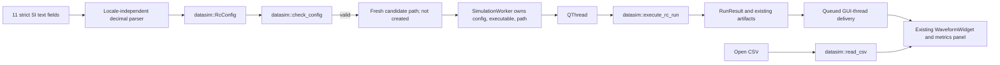

# Phase 5B architecture: manual ideal-RC workbench

## Existing architecture

The five production libraries and their public link graph are unchanged:

```text
datasim_vertical -> datasim_component + datasim
datasim_intake   -> datasim_component
datasim_pdf      -> datasim_intake
datasim          (independent)
datasim_component (independent)
```

The existing application target `datasim_viewer` is optional behind
`DATASIM_BUILD_DESKTOP=OFF`. It links `datasim` and Qt 6 Widgets. Phase 5A reads
CSV through `datasim::read_csv()` into `datasim::Samples` and paints those
samples in the existing `WaveformWidget`.

`datasim::RcConfig` fields and defaults remain the source of configuration
semantics: resistance 1000 ohm, capacitance 1e-6 F, source 5 V, initial voltage
0 V, delay 1e-3 s, rise/fall 1e-9 s, width 10e-3 s, period 20e-3 s, step 10e-6
s, duration 6e-3 s. `check_config()` applies all current supported-envelope
rules. `time_constant()` validates then returns R*C.

`execute_rc_run(config, executable, new_directory)` validates again, exclusively
creates its destination directory, runs ngspice, writes the existing run
artifacts, validates the samples on the common grid, and returns `RunResult` with
`Samples`, `Validation`, and `backend_seconds`. It preserves a failure workspace
and reports the error. The UI does not duplicate equations or validation logic.

## Application flow



The existing manual ideal-RC application path is independent of
`datasim_vertical`; no component review or approval state is consulted or changed.

## Input parsing

`parse_decimal()` uses `std::from_chars` with `std::chars_format::general`, checks
that every input character was consumed, and rejects parse errors and non-finite
values. The documented grammar uses ASCII decimal/scientific notation, `.` as the
decimal point, and no whitespace, grouping separators, unit suffixes, or implicit
unit conversion. The parsed values are assigned field-for-field to `RcConfig`,
then `check_config()` is called. Invalid input leaves the UI in `Failed`, does
not start a worker, and does not create a run directory.

## Worker and state lifecycle

The UI states are `Idle`, `Validating`, `Running`, `Succeeded`, and `Failed`.
Validation executes synchronously on the GUI thread and is bounded local work.
Only after it passes does the GUI select a fresh not-yet-created destination
path and construct a `SimulationWorker` with copies of `RcConfig`, executable
path, and output directory. The worker moves to a `QThread`; only its `execute()`
slot calls `datasim::execute_rc_run()`. Its result/failure signals are explicitly
queued to the window, so QWidget mutation remains on the GUI thread.

The Run and Open CSV controls are disabled while running, preventing a second
request from sharing mutable UI run state. There is no cancellation. `closeEvent`
ignores a close request while the worker thread is active, records that closing
was requested, and closes only after the queued completion path and thread
shutdown finish. The window remains alive as the receiver until then. Worker
exceptions are converted to a failure signal; `execute_rc_run()` retains the
failure directory and metadata. Old plotted data is cleared before a run begins
and on failure, so it cannot be presented as the failed run's result.

## Output directory policy

The user selects an existing parent directory. After configuration validation,
`fresh_run_directory()` creates a candidate name from a high-resolution clock
count and process-local atomic sequence, checks that the candidate does not
already exist, and returns without creating it. `execute_rc_run()` then owns
exclusive final directory creation. A race/collision fails safely through the
existing core contract. There is no automatic retry, overwrite, cleanup, or
deletion. Existing source CSV selection is independent of the output parent; the
CSV loader stays read-only.

The worker reports only artifact names that exist at completion. This includes
core artifacts such as `results.csv`, `errors.csv`, `circuit.cir`,
`run_metadata.json`, `validation_report.json`, and backend files such as
`ngspice.log`, `version.txt`, and `samples.dat` when present. The workbench does
not relabel `run_metadata.json` as vertical-slice provenance.

## Result and failure presentation

Success requires `execute_rc_run()` to return and `RunResult::validation.passed`
to be true. `Samples`, `backend_seconds`, `max_absolute_error_V`, `rmse_V`, and
`tolerance_V` come from that `RunResult`; Qt does not recalculate errors. The
display labels the output as a manual ideal-RC simulation and shows R, C, tau,
sample count, output path, validation status, and existing artifacts. A manually
loaded CSV is explicitly described as read-only CSV and not a newly executed
simulation.

## Dependencies and licensing

Qt 6 Widgets remains an application-only dependency. The default core build does
not discover Qt. Qt is not vendored, and the project license and any binary
redistribution policy remain owner decisions, as recorded by [ADR-0011](decisions/ADR-0011-desktop-visualization-foundation.md).
