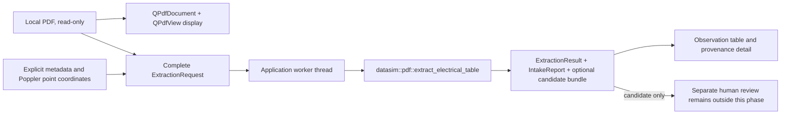

# Phase 5C architecture: Datasheet Evidence Workbench

## Existing state

The five production libraries keep their Phase 5B dependency graph:

```text
datasim_vertical -> datasim_component + datasim
datasim_intake   -> datasim_component
datasim_pdf      -> datasim_intake
datasim          independent
datasim_component independent
```

`datasim_viewer` is optional and application-only. The Phase 5B manual RC
workflow, `WaveformWidget`, asynchronous CSV loader, `RcConfig` validation, and
simulation worker remain on the first page of the viewer. Qt is not introduced
into production libraries.

## Phase 5C flow



Qt PDF renders and navigates pages. Poppler remains the deterministic text and
geometry extraction backend. `datasim_pdf` maps explicit user configuration to
existing intake/domain contracts. No `apply_review_decision()` call or
`ComponentKnowledge`/`ModelArtifactDescriptor` creation occurs in the workbench.

The extraction worker owns a value snapshot of `ExtractionRequest`. Its result
is delivered to the GUI with queued signal delivery. A changed document or form
field clears prior candidates and invalidates in-flight output using a request
key. The widget waits for its worker during destruction; there is no unsafe
cancellation path. Poppler process bounds remain owned by `datasim_pdf`.

## Coordinates

The application displays an explicit policy: extraction coordinates are
Poppler top-origin page coordinates in points. Qt display coordinates are not
converted into extraction coordinates. Numeric coordinate entry is the only
authoritative path; mouse selection is deferred.

## Dependencies

`DATASIM_BUILD_PDF_WORKBENCH` defaults to `OFF` and requires
`DATASIM_BUILD_DESKTOP=ON`. Default/core builds do not discover Qt. Desktop-only
builds still require only Qt Widgets. The PDF-enabled desktop target requires
Qt 6.11 `Pdf` and `PdfWidgets`; only `datasim_viewer` links these modules and
`datasim_pdf`.
