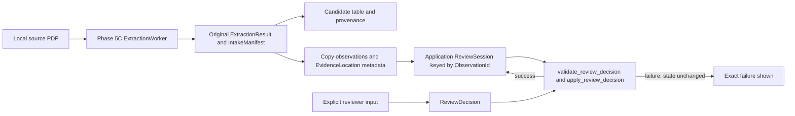

# Phase 5D architecture: In-memory engineering evidence review

## Current state before Phase 5D

Five production C++20 libraries retain the established dependency graph:

```text
datasim_vertical -> datasim_component + datasim
datasim_intake   -> datasim_component
datasim_pdf      -> datasim_intake
datasim          independent
datasim_component independent
```

Phase 5C's optional `datasim_viewer` uses Qt for display and the existing
Poppler-backed `datasim_pdf` adapter for bounded candidate extraction. It returns
an `ExtractionResult`, optional `IntakeManifest`, candidate observations,
diagnostics and provenance. It does not approve extracted observations.

## Phase 5D application flow



`ReviewSession` is Qt-free and owns observation copies, evidence-location
metadata, local history (the domain `review_history` vectors), and source/config
fingerprints. It enforces session ownership, evidence ownership, unique
`ObservationId`, unique `ReviewDecisionId`, and same-component/shared-source
replacement constraints. It calls `validate_review_decision()` and then
`apply_review_decision()` on a temporary observation copy before replacing the
session value. Failed validation leaves the session state and history unchanged.

The widget continues to display the immutable raw extraction result separately
from review state. A selected table row carries its `ObservationId`; row ordering
is not an identity. A complete PDF SHA-256 and configuration SHA-256 key the
session. Configuration edits invalidate displayed results; completion checks
the current source bytes and request key before accepting worker output.

## Trust boundary and limitations

`human_engineer` is application-supplied metadata. Reviewer ID and timestamp are
not authenticated, signed, or durable. The in-memory review session is lost when
discarded or the application exits. No review result is exported, promoted to
`ComponentKnowledge`, validated as a `ModelArtifactDescriptor`, or routed to
simulation. Approval of an observation does not approve a mathematical model.
Source PDF identity still depends on user configuration and the local file hash;
the hash is a freshness key, not a signature or publisher authentication.

Qt remains confined to the optional application target. Qt Svg is used only by
the PDF workbench for rendering the supplied resources; Poppler extraction and
all production library interfaces remain unchanged.
